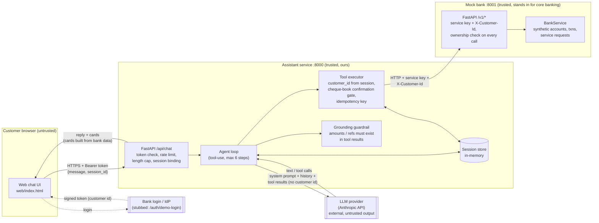

# Architecture

## Trust boundaries

| Boundary | What crosses | Control |
|---|---|---|
| Browser → Assistant | user text, token | Signed, expiring token; the customer identity is taken **only** from it; length cap, rate limit, sessions bound to customer |
| Assistant → LLM | prompt, history, tool results | Only data needed for the answer is sent; no credentials; the model never sees or sets `customer_id` |
| LLM → Assistant | text, tool calls | Treated as **untrusted input**: arguments validated, state-changing action gated server-side, final text checked for ungrounded figures |
| Assistant → Bank | tool calls | Service key + customer header; bank re-checks account ownership; idempotency key on writes |
| Bank data → LLM | narrations, merchants | Third-party text = data; prompt tells the model never to follow instructions inside it |

## Flow: "What was the 649 debit?"
1. UI sends text + token. API verifies token → `customer_id`, loads/creates the session.
2. Agent calls the LLM with the system prompt, history and tool schemas.
3. LLM decides (reasoning, no keyword rules) to call `get_accounts` then `search_transactions(direction=debit, min=max=649)`.
4. Executor calls the bank on behalf of the session's customer; results go back to the LLM and into the session's "grounded" record.
5. LLM writes the explanation. Guardrail checks every ₹ amount / reference exists in tool results. API returns reply plus a **card rendered from bank data**.

## Flow: cheque book
`request_cheque_book(confirmed=false)` stages → LLM asks the customer to confirm → customer replies in a **later** message → `request_cheque_book(confirmed=true)` executes with an idempotency key → bank returns `SR-…` → confirmation text and card both come from that response.
